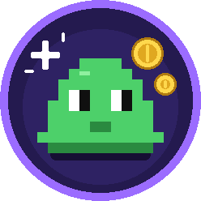
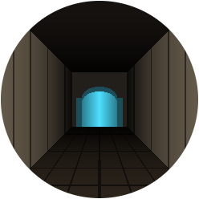
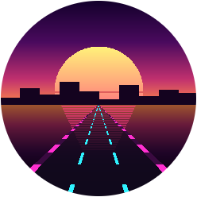
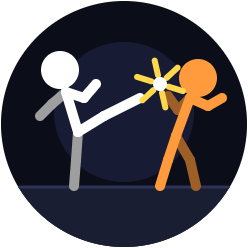

# Bip 6 Watch Games

Nine original games for the **Amazfit Bip 6** smartwatch, written in JavaScript for **Zepp OS** (API 4.0, 390×450 touch screen).

**[▶ Play them in your browser](https://tudormarianvlad.github.io/bip6-watch-games/)**: browser builds that fake the watch APIs, so you can try every game without a watch.

<table>
<thead>
<tr>
<th width="80"></th>
<th>Game</th>
<th>Genre</th>
<th>Watch features used</th>
</tr>
</thead>
<tbody>
<tr>
<td width="80" align="center"></td>
<td><strong>Tap Quest</strong></td>
<td>Idle clicker RPG: hire heroes, earn gold while away</td>
<td>Step counter, offline progress</td>
</tr>
<tr>
<td width="80" align="center"></td>
<td><strong>Wristlings</strong></td>
<td>Creature collecting and turn-based battles: 106 creatures (including holiday ones and rares), three-stage evolution lines, legends, step eggs, a weekly boss, book badges, status effects and battle weather</td>
<td>Steps, sleep, heart rate, calories, PAI, weather, compass, watch widget</td>
</tr>
<tr>
<td width="80" align="center"></td>
<td><strong>Depth Crawl</strong></td>
<td>First-person roguelite dungeon crawler</td>
<td>Step counter</td>
</tr>
<tr>
<td width="80" align="center"></td>
<td><strong>Neon Horizon</strong></td>
<td>Synthwave night racer</td>
<td>Step counter</td>
</tr>
<tr>
<td width="80" align="center"></td>
<td><strong>Stick Duel</strong></td>
<td>Swipe-controlled stickman fighter</td>
<td>Swipe gestures</td>
</tr>
<tr>
<td width="80" align="center"></td>
<td><strong>Tilt Arena</strong></td>
<td>Arena survival, steered by tilting your wrist</td>
<td>Accelerometer</td>
</tr>
<tr>
<td width="80" align="center"></td>
<td><strong>Orbit Pop</strong></td>
<td>Marble shooter</td>
<td>Touch aiming</td>
</tr>
<tr>
<td width="80" align="center"></td>
<td><strong>Mine Patrol</strong></td>
<td>Mine-sweeping puzzle</td>
<td>Best-time saves</td>
</tr>
<tr>
<td width="80" align="center"></td>
<td><strong>Alchemist's Cauldron</strong></td>
<td>Merge puzzle: brew ingredients up to the Philosopher's Stone</td>
<td>Swipe gestures, step counter</td>
</tr>
</tbody>
</table>

## Highlights

- **Built for tight hardware.** Smooth on a low-power watch thanks to dirty-region rendering (only redraw what changed) and a frame-rate-independent game loop.
- **Shared game systems.** Local saves, offline progress, upgrade and prestige loops, achievements, daily goals, step-counter rewards, interactive tutorials and animated swipe menus.
- **Original pixel art.** Sprites, UI and app icons are original pixel art, many of them drawn as code (pixel grids or shape lists) by small Node.js scripts in each game's `tools/` folder. Wristlings' creatures were generated with Google Gemini and brought in by the game's own importer ([`Wristlings/tools/import.cjs`](Wristlings/tools/import.cjs)).
- **Browser preview tool.** [`tools/preview.cjs`](tools/preview.cjs) bundles a game's page with a fake Zepp OS API layer and runs it in a web browser for fast iteration without the simulator.
- **Built with AI assistance.** Developed with Claude Code as a coding assistant.

## Project layout

```
<Game>/
  app.json        Zepp OS manifest (permissions, targets)
  app.js          app entry
  page/           game code (index.js + layout)
  assets/         icons and sprites per screen target
  tools/          sprite / icon generator scripts (some games)
tools/
  preview.cjs         browser preview builder  -> tools/preview/<Game>.html
  publish-demos.cjs   copies previews to docs/ for GitHub Pages
docs/             the playable web demos (GitHub Pages)
```

## Running a game

**On the watch or simulator:** install the [Zeus CLI](https://docs.zepp.com/docs/guides/tools/cli/), then from a game folder:

```bash
zeus dev      # run in the Zepp OS simulator
zeus build    # build an installable .zab into dist/
```

**In a browser:**

```bash
node tools/preview.cjs "Tap Quest"
```

To update the web demos after a change: rebuild the preview, then run `node tools/publish-demos.cjs`.

---

Personal project by Tudor Marian-Vlad. Not affiliated with Zepp Health or Amazfit.
